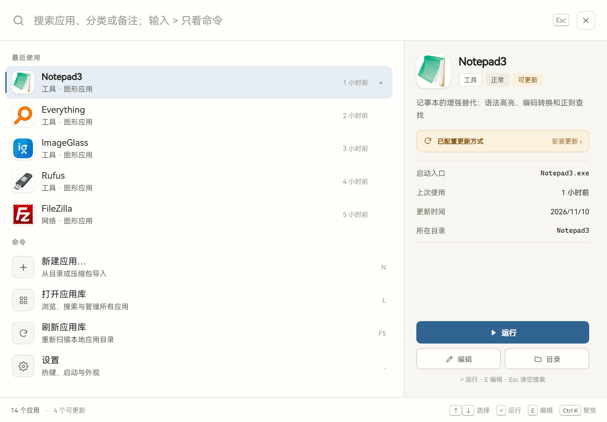
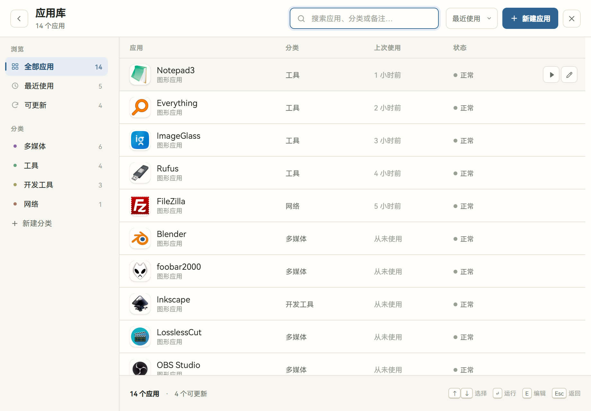

# App Runner

Windows 本地应用启动器，Go + Wails v3 实现。按 `Ctrl+Alt+Space` 唤出命令中心，窗口 920×640、无系统标题栏，单实例常驻托盘。





## 使用

- 输入即搜应用与命令，`>` 开头只列命令，Enter 启动。
- “打开应用库”可按分类筛选、拖拽改分类，也可编辑或新建应用。
- 关闭按钮收起窗口，托盘菜单退出。

## 应用库

子目录同时含有 `app.toml` 与 `content` 即一个应用：

```text
D:\Apps\
  editor\
    app.toml
    app.ico          # 可选图标
    content\
      editor.exe
  state.json         # 最近使用记录
```

```toml
title = "编辑器"
category = "开发工具"
type = "GUI"            # GUI | CLI
entry = "editor.exe"    # 相对 content，或以 re: 开头按文件名匹配
run_as_admin = false
updater = ["PIN:settings", "RMC", "UNPKG"]
```

## 构建

需要 Go 1.25+、Node.js 22.18+、npm 和 WebView2 Runtime。

```powershell
go install github.com/wailsapp/wails/v3/cmd/wails3@v3.0.0-beta.28
npm --prefix frontend ci
wails3 build
.\bin\app-runner.exe --app-dir "D:\Apps"
```

`--app-dir` 与 `USER_LOCAL_APP` 指定应用库，前者优先；开发模式用 `wails3 dev`。

## 配置

界面偏好（主题、运行后隐藏、空分类）保存在 `%APPDATA%\app-runner.exe`；应用配置与最近使用记录见上方应用库。
